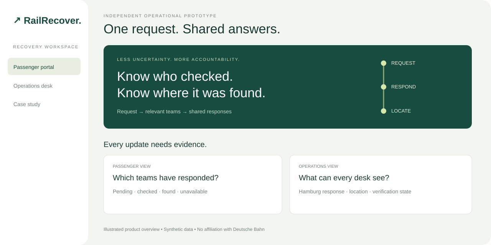
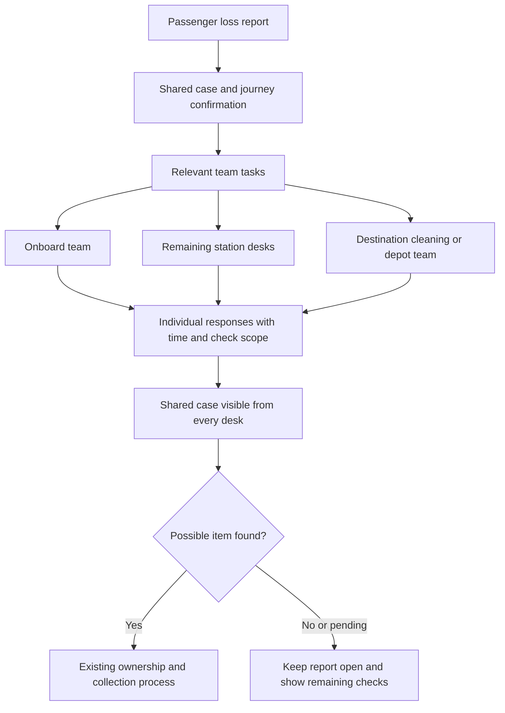
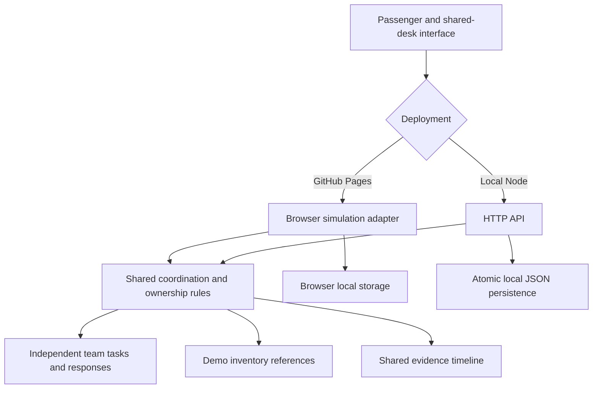
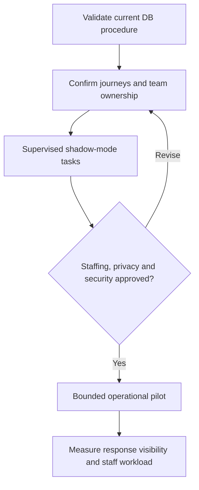

<div align="center">

# ↗ RailRecover

### One request. Shared answers.

**A route-based search coordination prototype: relevant railway teams respond, and every desk sees the same case.**

[Open the live demo](https://Jeevan-0508.github.io/DB-Rail-Recover/) · [Case 001](docs/case-studies/CASE-001-THE-BAG-THAT-DISAPPEARED.md) · [Operator pilot](docs/PILOT_PROPOSAL.md)




*Independent concept. Illustrated product overview. Synthetic data and journeys. No affiliation with Deutsche Bahn.*

</div>

<p align="center"><a href="docs/getting-started.md">Getting started</a> · <a href="docs/quality-review.md">Quality review</a></p>

## The situation we want to change

The first documented case study is [CASE-001 — The Bag That Disappeared](docs/case-studies/CASE-001-THE-BAG-THAT-DISAPPEARED.md). It is anonymised, unresolved and explicit about the difference between passenger testimony and independently verified evidence.

A passenger leaves a laptop bag on a train and reports it. At a station the next morning, they are told to wait at least three days and cannot obtain an answer about checks at other stations.

That is the passenger's reported experience, **not a verified universal DB policy**. The proposed improvement is concrete: a desk should be able to open the report and say **“Hamburg recorded a possible matching bag; here is the location and verification status”**, rather than having no shared response to consult.

## A shared search, not another lost-property database

DB already has NovaFind reporting, matching, notifications, storage workflows and internal history. RailRecover does not claim to invent those functions or prove that DB lacks internal coordination.

We propose a coordination layer **before or alongside inventory registration**: one report produces tasks for relevant teams, each response has an actor, time and check scope, and every participating desk can inspect the results. Production would reference the existing DB report and inventory rather than duplicate them.

## Request → teams → shared answer



Notify relevant teams, not every station in Germany. The destination team is included even when the passenger exits at the final stop. A station inventory check is different from a physical train sweep; the task identifies the intended scope.

## What each team reports

| Status | What it means | What it does not mean |
| --- | --- | --- |
| **Pending** | A local demo task exists; acknowledgment pending | A real message was delivered |
| **Accepted** | A demo team accepted the task | The bag was located |
| **Checked — not found** | A specified place was checked at a recorded time | The bag is permanently missing |
| **Found** | A registered item reference and storage location are available | The claimant owns it or can collect yet |
| **Unable to check** | A reason is recorded | The report is closed |

One negative response never replaces other pending responses. Even if every team reports a negative or unavailable check, the loss case stays open for later discoveries.

## See the Hamburg → Nürnberg example

1. [Open the demo](https://Jeevan-0508.github.io/DB-Rail-Recover/). The fictional backpack case already has five tasks: onboard, Würzburg, Hannover, Hamburg, and a Hamburg terminal team.
2. Choose **Operations desk** and set **View from desk → Hamburg Hbf**.
3. Open the backpack case → **Accept task** → **Record response**.
4. Choose **Found**, select the sample backpack and enter **“Checked the local found-item inventory; matching bag held here.”**
5. Change **View from desk → Nürnberg Hbf**. Nürnberg has no remaining-route search task, but it can read Hamburg's response and the recorded storage location.
6. Open **Passenger portal** and the same case. The location and individual team responses are also visible there.
7. To demonstrate collection, return to Hamburg / All desks → **Review ownership candidate** → **Verify ownership** with the fictional detail **Blue spiral notebook** → record a handover → confirm collection.

No one has to perform every step to demonstrate the main value. Steps 1–6 prove the shared visibility concept.

## The passenger and staff views

| Passenger | Relevant team | Any service desk |
| --- | --- | --- |
| Submit item, journey and optional report reference | Accept its own simulated task | Open the shared report |
| See which teams are pending or have responded | Record found, checked-negative or unavailable | See all team responses and check times |
| See possible item location and verification state | Link an existing demo inventory item | Explain where the item is recorded |
| Understand what remains unknown | Escalate overdue tasks | Avoid treating silence as a negative result |

The desktop selector simulates different desks; it is not authentication. Every visitor works with synthetic records.

## Urgent essentials

An **Urgent essentials** context uses illustrative targets of 15 minutes to acknowledge and 30 minutes to respond after acceptance. Standard demo targets are 30 and 60 minutes. Overdue pending or accepted tasks can be manually escalated.

These are proposed demo settings, **not DB commitments or recovery guarantees**. A real operator must agree capacity, priority eligibility and response targets. For medically essential items, seek replacement assistance while recovery continues.

## Architecture



**Pages:** interactive demo, local to each browser; all fictional evidence is inspectable in browser storage. **Node:** same domain rules enforced through an HTTP API, with persistent local records and private inventory details omitted from read responses. Neither mode sends tasks to real railway teams or connects to DB.

## Run locally

Node.js **22+**. No dependencies or keys required.

```powershell
npm.cmd start
```

Open **http://127.0.0.1:3000**. On macOS/Linux use `npm start`.

```sh
npm test
npm run check
npm run build
```

**11 tests** cover route recipient selection, partial/negative/unavailable responses, found-item references, acknowledgment and escalation gates, ownership and custody requirements, double claims, validation, API persistence, and the built Pages adapter.

`PORT` changes the port; `RAILRECOVER_DATA_DIR` changes local storage. Demo data is ignored by Git. Pages uses a fresh v2 storage namespace for this release. Legacy local records gain illustrative tasks when loaded; this does not reconstruct historical searches.

## Research boundary

| Established publicly | Still needs operator validation |
| --- | --- |
| DB has reporting, matching and successful-find notifications | Automatic physical-search dispatch from an online report |
| NovaFind supports history, roles, mobile preregistration and storage workflows | Exact DB early-search team routing and acceptance procedure |
| DB has station coordination infrastructure | Passenger-visible early-check outcomes and escalation |
| Items may reach the service after hours or 1–2 days | Feasible deadlines and cross-team access policies |

[Research and sources](docs/CASE_STUDY.md). Do not present a missing public description as proof of a missing internal capability.

## Path to an operator pilot



Start with DB InfraGO lost-property operations and DB Fernverkehr as proposed stakeholders. No endorsement, integration access or submission has been obtained. Production needs staff identity, passenger access isolation, operator-confirmed journeys, actual notification delivery and a transactional task service. [Pilot proposal](docs/PILOT_PROPOSAL.md).

## Repository guide

- [Case 001 — The Bag That Disappeared](docs/case-studies/CASE-001-THE-BAG-THAT-DISAPPEARED.md)
- [Existing-system comparison](docs/CASE_STUDY.md)
- [Coordination architecture and production requirements](docs/ARCHITECTURE.md)
- [Product vision](docs/PRODUCT-VISION.md)
- [Domain model](docs/DOMAIN-MODEL.md)
- [Workflows](docs/WORKFLOWS.md)
- [Security](docs/SECURITY.md) · [Privacy](docs/PRIVACY.md)
- [Demo guide](docs/DEMO-GUIDE.md) · [Testing](docs/TESTING.md) · [Limitations](docs/LIMITATIONS.md)
- [Research & impact](docs/RESEARCH-AND-IMPACT.md) · [Metrics dictionary](docs/METRICS-DICTIONARY.md)
- [Customer experience](docs/CUSTOMER-EXPERIENCE.md) · [Financial model](docs/FINANCIAL-MODEL.md) · [Pilot evaluation](docs/PILOT-EVALUATION.md)
- [Pilot scope and evaluation](docs/PILOT_PROPOSAL.md)
- [Domain and integration tests](test/)
- [Deployment workflow](.github/workflows/pages.yml)

Built by **Jeevan** · [MIT licence](LICENSE) · Independent operational prototype.
