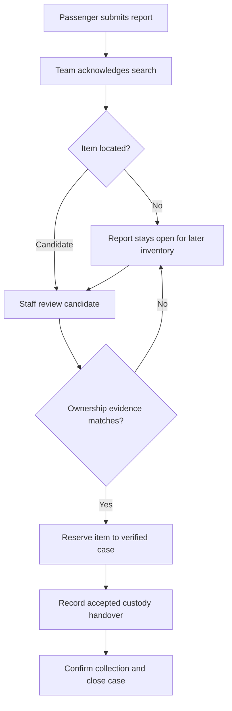
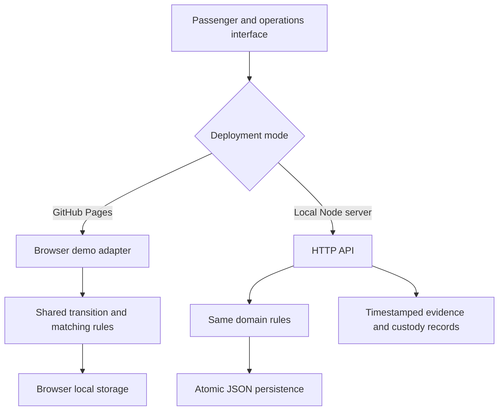
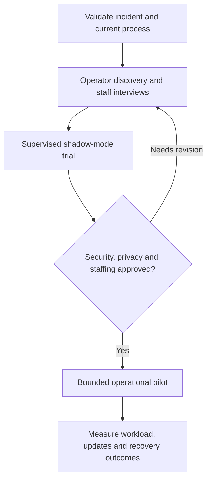

<div align="center">

# ↗ RailRecover

### A lost item shouldn't mean a lost trail.

**An operational prototype that turns a railway loss report into an accountable search and a verified return.**

[Explore the demo](https://Jeevan-0508.github.io/DB-Rail-Recover/) · [Case study](docs/CASE_STUDY.md) · [Pilot proposal](docs/PILOT_PROPOSAL.md)


*Illustrated product overview. Independent project, synthetic data, no affiliation with Deutsche Bahn.*

</div>

## The problem in one minute

You leave a laptop bag on a train. You report it immediately. But can you tell whether anyone has checked the train, who owns the search, or when to expect the next update?

DB already has loss reporting and inventory matching. **RailRecover explores the gap before an item is registered:** accountable search tasks, evidence-backed updates and visible custody handovers. It does not claim that DB has no internal communication infrastructure.

Inspired by an anonymised passenger account in Nürnberg. The broader gap is a hypothesis to validate with operators, not an established finding about the entire railway network.

## How recovery works



**A match is a candidate. Acknowledgment is not recovery. A negative train check does not close the report.**

## Two views, one evidence trail

| Passenger portal | Operations desk |
| --- | --- |
| Submit a fictional loss report | Accept an assigned search task |
| See the assigned team and deadline | Record a check or escalate an overdue task |
| Follow timestamped progress | Register found items and review candidates |
| See verified storage and return status | Verify ownership and record custody/collection |

The case-study view explains the incident, verified process facts and the proposed pilot.

## Try the demo in five minutes

Open **[RailRecover on GitHub Pages](https://Jeevan-0508.github.io/DB-Rail-Recover/)** once its deployment succeeds.

1. Open the sample backpack report in **Passenger portal**.
2. Switch to **Operations desk**, select that case and **Acknowledge search**.
3. **Link for human review** on the sample backpack.
4. Choose **Verify ownership**. Try an incorrect detail first; the item remains withheld.
5. Enter the fictional sample detail **Blue spiral notebook**.
6. Record an accepted handover to **Demo collection desk**.
7. Confirm simulated collection. Return to the passenger view to inspect the timeline.

Alternative: record **No item found** after acknowledgment. The report stays open for a later match. Register another fictional found item to explore candidate ranking.

## What makes this more than a form

| Control | Behaviour |
| --- | --- |
| Separate task and case states | A completed search can leave the loss report open |
| Explained matching | Category, train label, date and colour produce a transparent relevance score |
| Ownership gate | A high score never proves ownership |
| Reservation | Two cases cannot verify against the same reserved item |
| Custody gate | Collection requires a recorded accepted handover |
| Audit timeline | Actions, outcomes and timestamps remain visible |
| Overdue escalation | Unacknowledged tasks can be escalated after the demo deadline |

No fabricated recovery rates, financial savings or accuracy claims.

## Architecture: live demo and local backend



| | GitHub Pages | Local server |
| --- | --- | --- |
| Purpose | Public interactive demonstration | Backend workflow prototype |
| Persistence | This browser only | Local JSON file across restarts |
| Rules | Run in the browser | Enforced by the server |
| Private sample details | Inspectable by a browser user; no security boundary | Omitted from API read responses |
| Real operator integration | None | None |

Both modes are synthetic demos. The view switch is not authentication. Never enter real personal, employer or device secrets.

## Run locally

Requires **Node.js 22+**. No packages, keys or installation are needed.

```powershell
# From the project directory on Windows
npm.cmd start
```

Open **http://127.0.0.1:3000** and keep the terminal open.

On macOS/Linux, use `npm start`. `PORT` changes the port; `RAILRECOVER_DATA_DIR` changes the storage directory. The server binds to localhost by default.

```sh
npm test
npm run check
npm run build
```

Eight tests cover verification and custody gates, negative searches, evidence withholding, double claims, escalation, invalid input, the HTTP workflow with restart persistence, and the built Pages demo workflow. `npm run build` produces the static Pages demo in `dist/`.

## Deploy with GitHub Pages

The [deployment workflow](.github/workflows/pages.yml) tests, checks and builds the project before publishing.

Repository owner setup: **Settings → Pages → Build and deployment → Source → GitHub Actions**. Then run the workflow from **Actions → Test and deploy RailRecover → Run workflow**, or push a commit to `main`.

Expected address: `https://Jeevan-0508.github.io/DB-Rail-Recover/`. A link alone does not confirm a successful deployment; check the workflow's result.

## Research, not assumptions dressed as facts

| Verified public baseline | Product implication |
| --- | --- |
| DB has online reports and found-item matching | Complement existing inventory workflows |
| Items can take hours or 1–2 days to reach the service | Distinguish intake from physical recovery |
| End-of-journey finds usually go to the destination office | Investigate journey-linked routing |
| Uncollected items move to Wuppertal after seven days | Make custody transfers traceable |
| SBB offers a conditional express search | Explore an early-search pilot with staffing constraints |

Sources and limitations: **[full case study](docs/CASE_STUDY.md)**. Research snapshot: 12 October 2026. The reported three-working-day wait is not verified as a universal DB rule.

## A path to operator adoption



Proposed initial stakeholders: DB InfraGO lost-property operations and DB Fernverkehr. No contact, endorsement or adoption has been secured. The next step is a process-validation conversation, not unsupervised deployment with passenger data.

**[Read the pilot proposal](docs/PILOT_PROPOSAL.md)** for scope, questions, evaluation and handover options.

## Scope and roadmap

| Available now | Required for a real operator pilot |
| --- | --- |
| Responsive UI and complete synthetic workflow | Passenger accounts, staff SSO and object-level access control |
| Deterministic matching | Validated journey instances, overnight trips and actual team routing |
| Manual escalation and on-screen updates | Agreed deadlines, background workers and email/SMS delivery |
| Demo custody records | Independent sender/receiver identities and accepted transfers |
| Local JSON persistence | Transactional database, backups and secure hosting |
| Application audit events | Access auditing and tamper-resistant records |
| Private-detail check | Operator-approved ownership evidence and dispute handling |

## Explore the repository

- **[Case study](docs/CASE_STUDY.md)** — incident, gap hypothesis and primary sources
- **[Architecture](docs/ARCHITECTURE.md)** — domain model, transitions and production requirements
- **[Pilot proposal](docs/PILOT_PROPOSAL.md)** — how to evaluate this with an operator
- **[Tests](test/)** — safeguards and backend integration verification

Built by **Jeevan** · [MIT licence](LICENSE) · Independent concept, not an official railway service.
